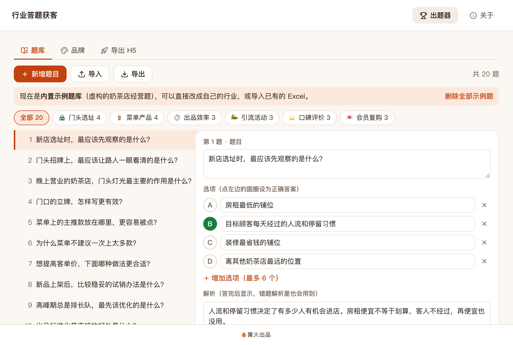
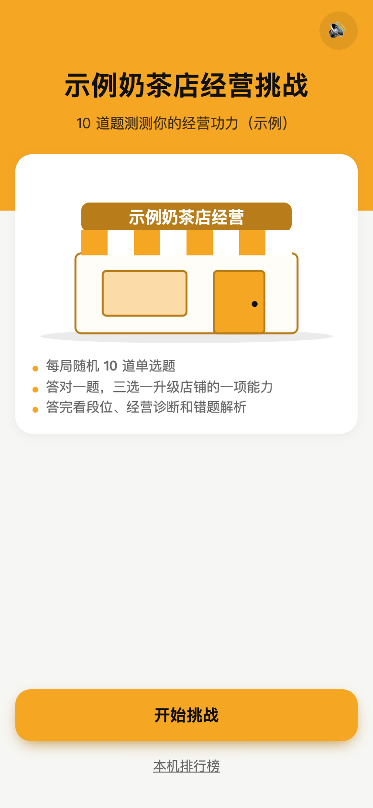
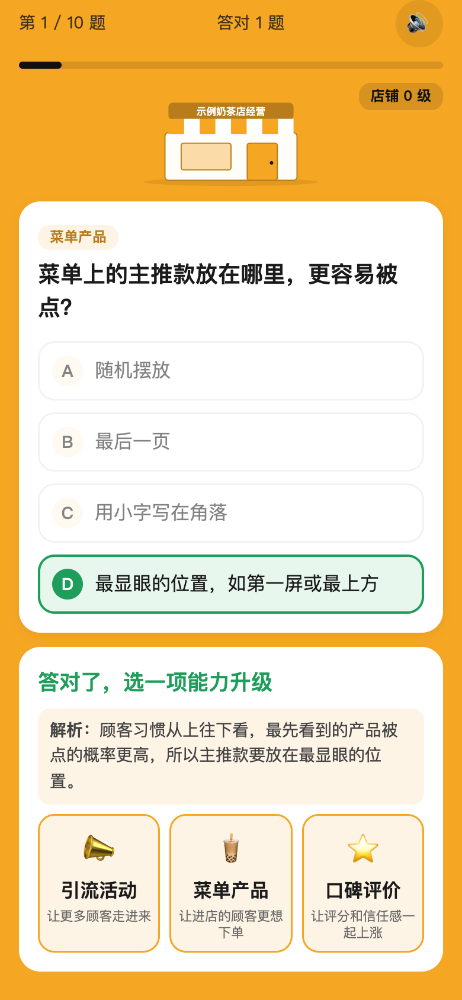
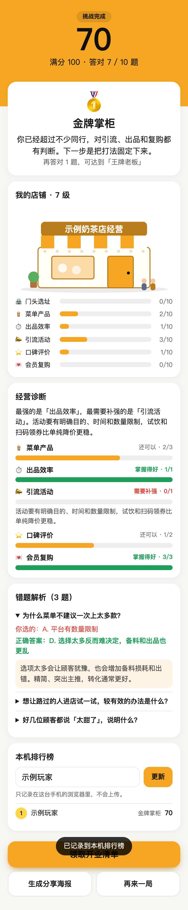

# 行业答题获客

> 篝火出品 · 收录于篝火 App 应用区

可换题库、可换品牌的手机答题小游戏，答完看段位、领资料、引导加微信



> 截图里的题库和品牌都是「示例」：虚构的奶茶店经营题，请换成你自己的行业。

下面三张是导出的手机页面（390 像素宽的浏览器视口，**示例**数据）：

| 首页 | 答题与升级 | 结果页 |
|---|---|---|
|  |  |  |

## 下载

到 [Releases](https://github.com/campfire-code/quiz-lead-game/releases/latest) 下载对应安装包：

| 电脑 | 文件 |
|---|---|
| Windows 10 / 11 | `quiz-lead-game_版本号_windows-x64-setup.exe` |
| Mac（Apple 芯片） | `quiz-lead-game_版本号_mac-arm64.dmg` |
| Mac（Intel 芯片） | `quiz-lead-game_版本号_mac-x64.dmg` |

第一次打开：
- **Windows**：如果弹出「Windows 已保护你的电脑」，点「更多信息」→「仍要运行」。
- **Mac**：如果提示「无法验证开发者」，打开「系统设置 → 隐私与安全性」，在下方点「仍要打开」。

## 能做什么

这个工具有两部分，放在同一个仓库里：

1. **出题器**（桌面软件）：编辑题库、设置品牌、导入导出 Excel / JSON，点一下「导出 H5」生成网页文件夹。
2. **H5 模板**（`h5-template/`）：手机答题网页。每局随机抽题、答对三选一升级店铺的六项能力、按分数评段位、结果页有经营诊断和错题解析、可生成分享海报、答完进入领奖页（引导加微信）。排行榜只记录在玩家自己的手机浏览器里，不联网。音效由浏览器当场合成，没有音频文件。

## 怎么用

1. **题库**页：左边是题目清单（可按维度筛选），右边编辑题目、2～6 个选项、点字母圆圈设正确答案、写解析、选所属维度。第一次打开是 20 道虚构的奶茶店示例题，可「删除全部示例题」后写自己的。
2. **导入**：支持 `.xlsx`、`.csv`、`.json`，也可以直接把文件拖进窗口。表格第一行是表头：`题目、选项A～选项F、正确答案、解析、所属维度`（顺序不限；也认「问题」「答案」「维度」等写法）。正确答案可写字母（B）、序号（2）或选项原文；所属维度写「品牌」页里的维度名称，对不上的会先归到第一个维度并提示。题目文字相同的算重复，自动跳过。「导出」里有带 2 道示范题的 Excel 模板。
3. **品牌**页：品牌名称、首页副标题、主色（文字颜色自动选黑或白）、每局题数、Logo、分享链接，领奖页的标题、引导文案、二维码说明与结尾二维码图片，4 档段位（名称、图标、起始分数、说明），6 个维度（名称、图标、升级说明、诊断建议）。图片支持 png / jpg / webp / gif，每张不超过 2 MB。
4. **导出 H5**页：上方是导出前检查（错误必须改，提醒可以不管），右侧是手机页面预览，可以直接点着玩。点「导出 H5」选一个文件夹，会生成「品牌名-答题H5」文件夹：`index.html`、`app.js`、`style.css`、`config.js`（题库与品牌）、`assets/`（Logo 和二维码）、`部署说明.txt`。
5. 把整个文件夹上传到任何能放静态网页的地方（自己的服务器、对象存储的静态网站等），手机打开 `index.html` 所在网址即可；双击 `index.html` 也能直接在浏览器里看效果。改了题库就重新导出，覆盖原文件。

项目（题库和品牌）自动保存在本机的 `settings.json`，不联网。换电脑前请用「导出 Excel」备份题库；品牌设置需要重新填写。

## 放到自己的公众号网页里：微信分享卡片

本工具**不做**微信分享卡片（需要公众号的 JS-SDK 和服务器端签名）。如果你把导出的页面放进自己的公众号网页，大致需要：

- 在公众号后台把页面所在域名加入「JS 接口安全域名」（**未核实**，以微信官方文档为准）；
- 你自己的服务器用公众号的凭证获取签名，页面调用 `wx.config` 后再设置分享标题、描述和图片（**未核实**具体接口与字段，请按微信官方文档接入）；
- 把这段代码加到导出的 `index.html` 里；公众号凭证只能放在你自己的服务器上，**不要**写进网页。

不接入也不影响使用：玩家可以在微信里直接转发链接，或用页面里的「生成分享海报」。

## 验收用例

| 操作 | 应得到 |
|---|---|
| 第一次打开，看「题库」页 | 共 20 题，6 个维度筛选条的题数为 4、4、3、3、3、3；顶部提示「现在是内置示例题库」；导出页没有错误，只有两条提醒（没有二维码、没有 Logo） |
| 点「导入」选 `samples/宠物店题库示例.xlsx` | 提示「从「宠物店题库示例.xlsx」导入 6 道题（1 道重复已跳过，1 个空行已跳过）」，共 26 题 |
| 把 `samples/宠物店题库示例.json` 拖进窗口 | 提示「从「宠物店题库示例.json」导入 2 道题」；这 2 道是 xlsx 里前两道题，若已导入过 xlsx，则提示「导入 0 道题（2 道重复已跳过）」；只做这一步时共 22 题 |
| 新增题目，题目留空、不设正确答案 | 该题在清单里出现警告图标；「导出 H5」页显示错误并且按钮不能点 |
| 「品牌」页把主色改为 `#1E3A8A` | 导出页预览里按钮和背景变深蓝，文字自动变白 |
| 「品牌」页选一张二维码图片，点「导出 H5」选文件夹 | 生成「示例奶茶店经营挑战-答题H5」，里面有 `index.html`、`app.js`、`style.css`、`config.js`、`部署说明.txt` 和 `assets/qr.*` |
| 双击导出的 `index.html`，点「开始挑战」答 10 题 | 每题答完立刻标出对错；答对出现三选一升级，选后店铺变化；答错显示正确答案和解析；答完进入结果页，有分数、段位、店铺六项能力、经营诊断、错题解析 |
| 结果页填昵称点「上榜」 | 排行榜出现这一条（只在这台浏览器里）；换一个浏览器看不到 |
| 点「生成分享海报」 | 弹出海报，含分数、段位、六项能力和一个二维码；「保存图片」可下载 |
| 点底部主按钮 | 领奖页显示引导文案和你上传的二维码 |

## 对照说明与限制

- 每局的分数 = 答对数 ÷ 题数 × 100（四舍五入）；段位按起始分数分档。
- 题库少于每局题数时，每局把全部题出完；题库足够时优先抽没出现过的题。
- 没有做：服务器、后台账号、埋点统计、每日次数限制、分享解锁次数、邀请裂变、微信分享卡片。排行榜只有本机记录，没有全网榜。
- 海报里的二维码指向「当前页面网址」；在本机双击打开时不是可访问网址，请放到正式网址后再生成，或在「品牌」页填固定的分享链接。

## 自己编译

需要 Node.js 22、pnpm、Rust。

```bash
pnpm install
pnpm test          # 单元测试
pnpm tauri dev     # 开发运行
pnpm tauri build   # 打包
```

界面框架在 `src/kit`（所有 campfire-code 工具共用），本工具的逻辑在 `src/tool`。

## 归属

本工具由**篝火**出品，是篝火 App 应用区收录的开源工具之一，由篝火（GitHub 组织 [campfire-code](https://github.com/campfire-code)）维护与更新。全部工具的目录见 [toolkit-hub](https://github.com/campfire-code/toolkit-hub)。

## 许可证

MIT，版权方为篝火（campfire-code）。
